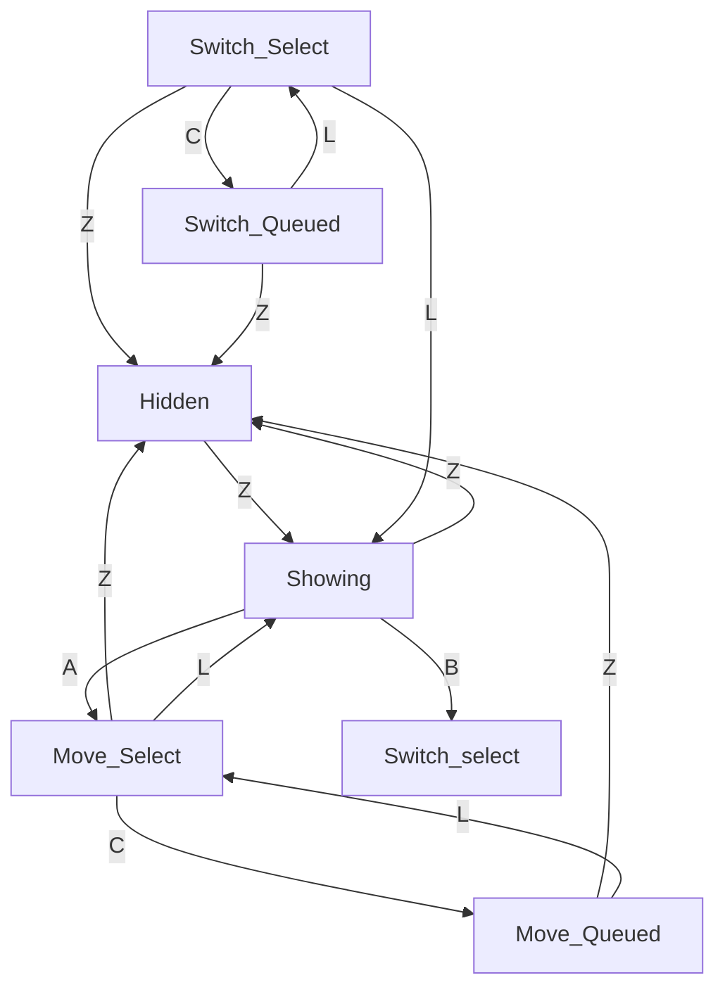

# What it is

During move resolution, the player can press Z to queue open the battle command select menu and decide their next move while move resolution is happening. That move will then be automatically be entered if the player doesn't cancel the queue.

Display State machine: 

An queued order is canceled:
- Any time the player presses Z, including during command selection
- If the player is still in any state other than `Move_Queued` or `Switch_Queued` when move resolution finishes
- The order becomes illegal (due to fainting, freeze, trapping, etc.)

Command selection should follow send the order as soon as possible (10 frames in zero).